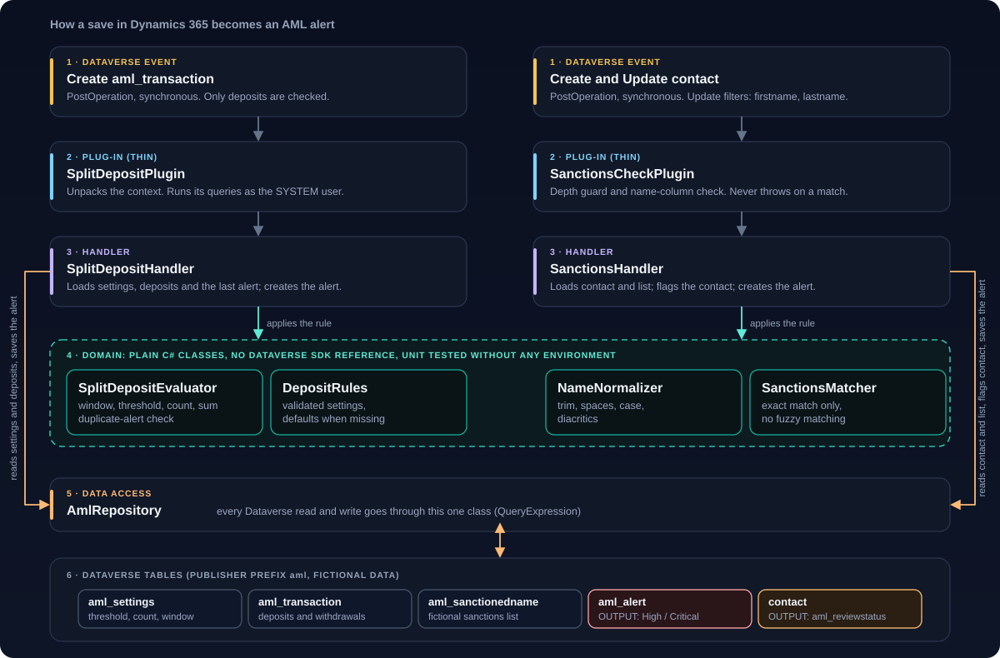
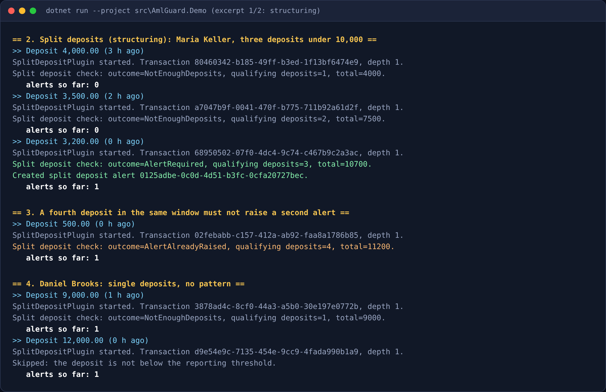
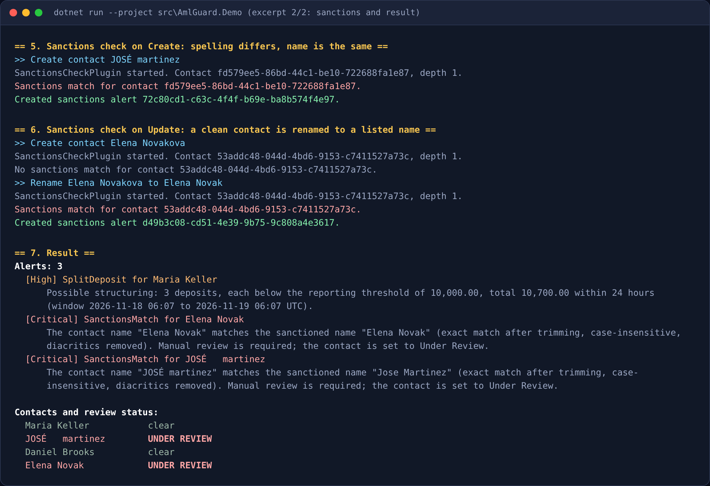

# AML Guard for Dynamics 365 CRM – Anti-Fraud Plugins

[](https://github.com/amirhosein2015/dynamics365-crm-aml-guard-plugins/actions/workflows/ci.yml)


Two synchronous Dataverse plug-ins for a fictional bank CRM: one detects **split deposits (structuring)**, the other screens contacts against a **sanctions list**. The business rules are plain C# classes with no Dataverse SDK reference, so they are unit tested without any Dynamics environment.

> **Educational project with fictional data.** Not a real compliance product; never use it for real AML decisions.

<p align="center">
  
</p>

## See it run

The demo runs the real plug-in classes against an in-memory Dataverse: three small deposits raise one alert, a fourth does not raise a second, and two sanctioned names are caught on **Create** and on **Update**, even with different spelling.

<p align="center">
  
</p>

<p align="center">
  
</p>

<sub>Console output of `dotnet run --project src\AmlGuard.Demo`, rendered as images from the captured text in [`docs/demo-output.txt`](docs/demo-output.txt). Lines without a prefix are `ITracingService` trace output, the kind of lines you would read in the Plugin Trace Log.</sub>

## What it does

| | Split deposit detection | Sanctions check |
|---|---|---|
| **Trigger** | Create of `aml_transaction`, PostOperation, synchronous | Create and Update of `contact` (filtering: `firstname`, `lastname`), PostOperation, synchronous |
| **Rule** | A deposit below the reporting threshold, plus enough other deposits below it within the window, whose sum reaches the threshold | Full name equals a sanctioned name after normalization: trim, collapse spaces, ignore case, remove diacritics. No fuzzy matching |
| **Settings** | Read from `aml_settings`, never hard-coded: `ReportingThreshold` (10,000), `MinDepositCount` (3), `WindowHours` (24) | The `aml_sanctionedname` table |
| **Result** | `aml_alert`: Split Deposit, severity High, with a description that states count, total and window | `contact.aml_reviewstatus = Under Review` and `aml_alert`: Sanctions Match, severity Critical |
| **Safeguards** | No duplicate alert for the same customer inside the same window | **No exception on a match** (it would roll back the alert). Loops are prevented by filtering attributes, a name-column check and a depth guard |

## Design decisions and trade-offs

The full list with reasoning is in [`docs/decisions.md`](docs/decisions.md). The ones that matter most:

| Decision | Why | Trade-off |
|---|---|---|
| Rules live in a `Domain` namespace with no SDK reference, and an architecture test enforces it | Fast, mock-free unit tests for the logic that matters | One extra layer to map data into |
| Plug-in → handler → repository | Each layer has one reason to change | More files for a small project |
| Thresholds come from `aml_settings` | Compliance can change them without a deployment | An invalid value falls back to defaults, so a typo cannot stop deposits (the trace says so) |
| A sanctions match never throws | An exception rolls back the transaction, including the alert that documents the match | The save goes through and a human reviews the contact |
| Three layers against infinite loops | The plug-in updates the contact itself | Depth limit is 2, so deeper automation chains are skipped |
| Queries run as the SYSTEM user | The rule must see every deposit, not only those the current user may read | The alert is created by SYSTEM, not by the teller |
| Fail closed if the check itself fails | A broken control should not be skipped silently | A bug can block a save; one catch block changes this |
| One strong-name signed assembly, .NET Framework 4.6.2 | The documented plug-in target; no dependent assembly to package | Logic and plug-in share an assembly |

## Tech stack

C# · .NET Framework 4.6.2 (plug-in, strong-name signed) · `Microsoft.CrmSdk.CoreAssemblies` 9.0.2.60 · xUnit · [DataverseFakes.Community](https://www.nuget.org/packages/dataversefakes.community) (in-memory Dataverse for integration tests) · GitHub Actions

## Run it

Needs Windows with the .NET SDK and the .NET Framework 4.8 developer pack (Visual Studio Community includes both). No Dataverse environment is required.

```powershell
git clone https://github.com/amirhosein2015/dynamics365-crm-aml-guard-plugins.git
cd dynamics365-crm-aml-guard-plugins

dotnet test                                   # 127 tests
dotnet run --project src\AmlGuard.Demo        # the scenario shown above
```

## Tests

127 automated tests, also run on every push by GitHub Actions.

- **Split deposit rule:** below, at and above the threshold; exact count and sum boundaries; window edges (exactly 24 h inside, one second outside); duplicate-alert prevention, including closed alerts; custom settings.
- **Name matching:** spaces, case, diacritics (precomposed and decomposed), empty and malformed input, no match, partial names, reversed order.
- **Plug-ins on an in-memory Dataverse:** alert fields, settings stored as Currency or Decimal, invalid settings, withdrawals ignored, other customers ignored, Create and Update, the loop scenario, wrong message or table.
- **Architecture:** the `Domain` namespace never references the Dataverse SDK.

## Status and limitations

- **Not registered on a live Dataverse environment.** Microsoft stopped creating free developer environments for new sign-ups on 15 November 2026, and the Developer Plan needs a work or school account. The plug-in logic and its behaviour in the event pipeline are tested on an in-memory Dataverse. That does **not** reproduce real transactions and rollback, sandbox limits, step registration or the real Plugin Trace Log. The registration steps are written down in [`docs/registration.md`](docs/registration.md) but have not been run.
- The demo runs on the in-memory Dataverse. A runner for a real environment (ServiceClient) is not included; the scenario code only needs `IOrganizationService`.
- The whole sanctions list is loaded and compared in memory on every screening. Fine for a demo; a large list would need a precomputed normalized column and an indexed lookup.
- Matching is exact by design: a reversed word order does not match, and letters without a Unicode decomposition (for example the Polish ł) are not folded. Tests document both.
- Deactivated sanctions rows are still used, and one `aml_settings` row is assumed.
- One query returns at most 5,000 deposits for the window.

## Repository layout

```text
src/AmlGuard.Plugins/    plug-in assembly (net462, signed)
  Domain/                business rules, no SDK reference
  Handlers/              read inputs, call the rules, write alerts
  Data/                  AmlRepository, the only class that queries Dataverse
  Schema/                table and column names, choice values
src/AmlGuard.Demo/       console demo on an in-memory Dataverse
tests/AmlGuard.Tests/    unit, integration and architecture tests (xUnit)
docs/                    data model, decisions, registration steps, demo script
```

## Documentation

[Data model](docs/data-model.md) · [Design decisions](docs/decisions.md) · [Registration steps](docs/registration.md) · [2-minute demo script](docs/demo-script.md)

## License

[MIT](LICENSE). All names and data are fictional.
